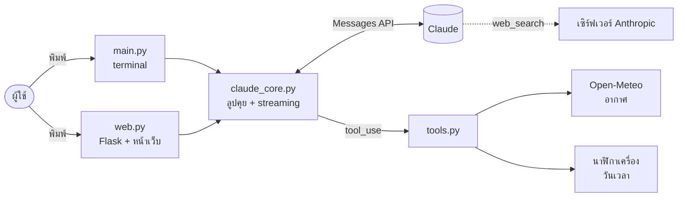

<div align="center">


**แชทกับ Claude ได้ทั้งใน terminal และหน้าเว็บ · ค้นเว็บ ดูอากาศ บอกวันเวลาได้ · ตอบแบบ streaming ทีละตัวอักษร**


</div>

---

## ✨ ทำอะไรได้บ้าง

| | ความสามารถ | รายละเอียด |
|:-:|---|---|
| 💬 | **2 หน้าจอในโค้ดเดียว** | ใช้ใน terminal (`main.py`) หรือหน้าเว็บ (`web.py`) ได้ โดยใช้แกนเดียวกัน |
| ⚡ | **Streaming** | คำตอบขึ้นทีละส่วนแบบเรียลไทม์ ไม่ต้องรอจนจบ |
| 🔎 | **ค้นเว็บ** | Claude ค้นข้อมูลล่าสุดเองเมื่อจำเป็น (สูงสุด 5 ครั้งต่อคำตอบ) |
| 🌤️ | **พยากรณ์อากาศ** | ดึงอากาศปัจจุบันจาก [Open-Meteo](https://open-meteo.com) ฟรี ไม่ต้องใช้ key |
| 🕒 | **วันเวลา** | บอกเวลาปัจจุบันตาม timezone (ค่าเริ่มต้น Asia/Bangkok) |
| 🧠 | **เลือกโมเดลและความลึกในการคิด** | ตั้งค่าใน `.env` ได้ ไม่ต้องแก้โค้ด |
| 🛡️ | **จัดการ error ครบ** | key ผิด, เรียกถี่เกิน, เน็ตหลุด, ถูกปฏิเสธ แจ้งเป็นภาษาไทยและไม่ทำให้บทสนทนาเสีย |

## 🏗️ การทำงาน



## 🚀 เริ่มใช้งาน

**1. ติดตั้ง**

```powershell
python -m pip install -r requirements.txt
copy .env.example .env
notepad .env
```

**2. ใส่ API key** ใส่ `ANTHROPIC_API_KEY` ในไฟล์ `.env` (สร้าง key ได้ที่ https://platform.claude.com/settings/keys ต้องเติมเครดิตก่อนใช้)

> 🔒 ไฟล์ `.env` อยู่ใน `.gitignore` แล้ว key จะไม่ถูก push ขึ้น GitHub

**3. รัน**

| แบบ | คำสั่ง | แล้ว |
|---|---|---|
| 🌐 หน้าเว็บ | `python web.py` | เปิด http://127.0.0.1:5000 |
| 🖥️ Terminal | `python main.py` | พิมพ์ `reset` เริ่มใหม่ · `exit` ออก |

## ⚙️ ตั้งค่า (ในไฟล์ `.env`)

| ตัวแปร | ค่าเริ่มต้น | ความหมาย |
|---|---|---|
| `CLAUDE_MODEL` | `claude-opus-5-5` | เปลี่ยนเป็น `claude-sonnet-5-5` หรือ `claude-haiku-5-5` (ถูกที่สุด) เพื่อประหยัด |
| `CLAUDE_EFFORT` | `medium` | ความลึกในการคิด `low` / `medium` / `high` / `xhigh` / `max` |
| `SYSTEM_PROMPT` | ผู้ช่วยทั่วไป | นิสัย/บทบาทของบอท เช่น พนักงานตอบลูกค้า |

## 🛠️ เครื่องมือที่ Claude ใช้ได้

| เครื่องมือ | ทำงานที่ | รายละเอียด |
|---|---|---|
| `web_search` | เซิร์ฟเวอร์ Anthropic | ค้นข้อมูลล่าสุดจากเว็บ (สูงสุด 5 ครั้งต่อคำตอบ, มีค่าใช้จ่ายต่อครั้ง) |
| `get_weather` | เครื่องคุณ | อากาศปัจจุบันจาก Open-Meteo |
| `get_current_time` | เครื่องคุณ | วันเวลาปัจจุบันตาม timezone |

<details>
<summary>➕ อยากเพิ่มเครื่องมือเอง</summary>

แก้ใน `tools.py` 4 จุด:

1. เพิ่มคำนิยามใน `CLIENT_TOOLS`
2. เขียนฟังก์ชันที่ทำงานจริง
3. ใส่ชื่อฟังก์ชันใน `_HANDLERS`
4. เพิ่มการตรวจค่าที่รับเข้ามาใน `_validate`

</details>

## 📁 โครงสร้าง

```
claude-api-chat/
├── claude_core.py    ตั้งค่า + ลูปคุยกับ Claude (streaming, เครื่องมือ, จัดการ error)
├── tools.py          เครื่องมือที่รันบนเครื่องคุณ
├── main.py           แชทใน terminal
├── web.py            เซิร์ฟเวอร์หน้าเว็บ (Flask, ส่งคำตอบแบบ NDJSON stream)
├── templates/        หน้าเว็บ
├── requirements.txt
└── .env.example      ตัวอย่างไฟล์ตั้งค่า
```

---

<div align="center">

ทำโดย [**gamezaa007**](https://github.com/gamezaa007) · ถ้าชอบ กด ⭐ ให้หน่อยนะครับ

</div>
